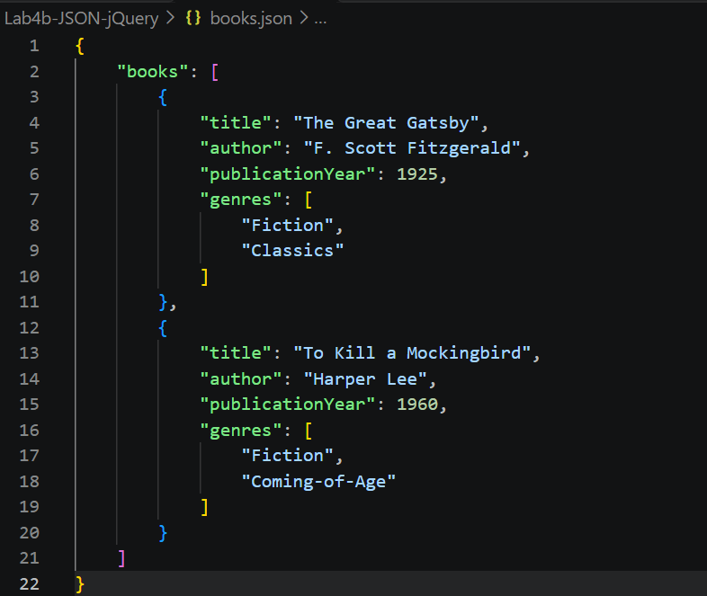
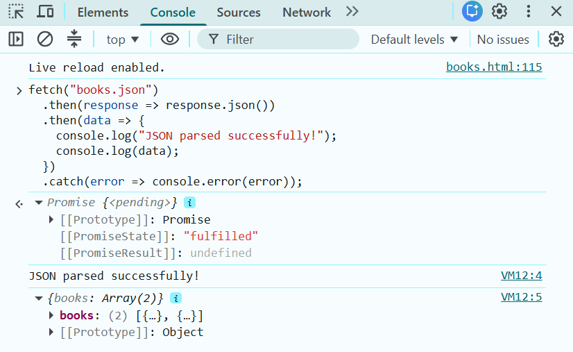
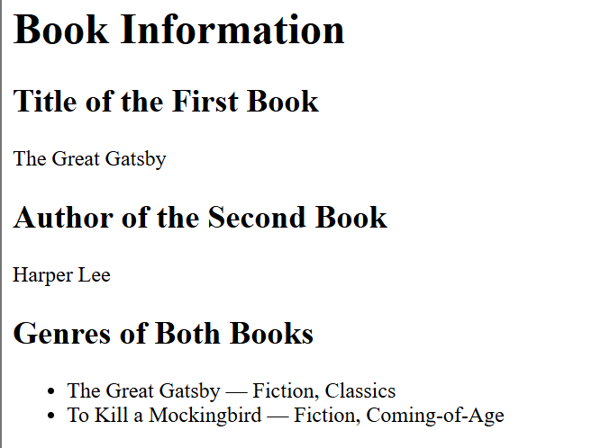
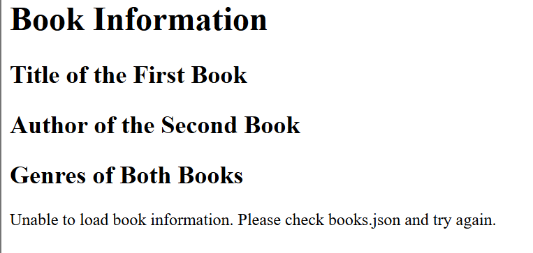
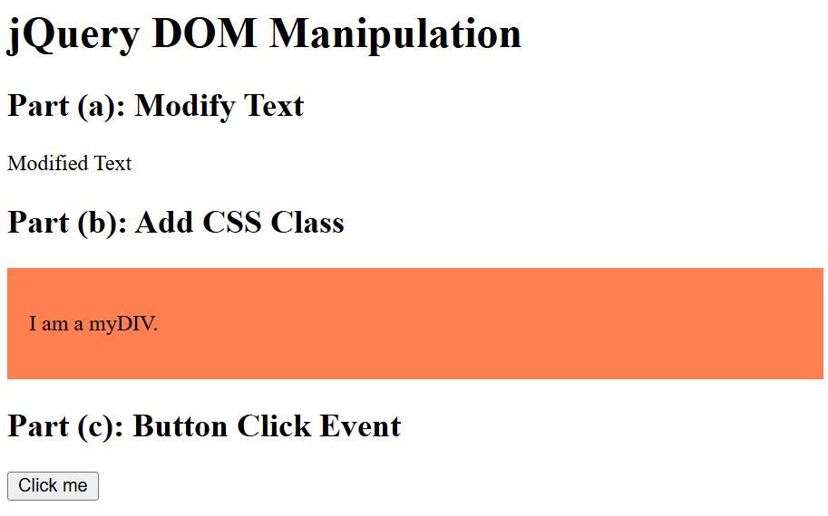
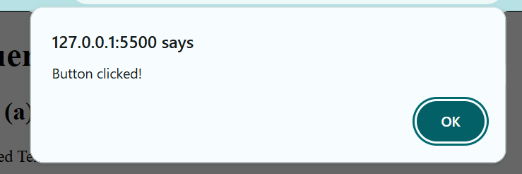

# BIC21203 Web Development - Lab 4b

## Student Information
Name: CHING PEI YEE
Student ID: AI240139
Course: BIC21203 Web Development
Lab: Lab 4b - Client-Side Scripting (JSON and jQuery)
Academic Session: 2026/2027

## Introduction
This lab focuses on JSON data handling, the
JavaScript fetch() API, DOM manipulation, and
jQuery event handling.

## Question 1: Create and Structure JSON Data

A JSON file named books.json was created to store
information about two books. Each book contains
a title, author, publication year, and genres.
The JSON file uses a top-level books array.

### How to Run
1. Open books.json in VS Code.
2. Check the JSON structure and data types.
3. Validate that the JSON parses successfully.

### Screenshots

## Question 2: Retrieve and Display JSON Data

The books.html webpage uses the JavaScript fetch()
API to retrieve data from books.json. It displays
the title of the first book, author of the second
book, and genres of both books. Error handling is
included for unsuccessful requests or invalid JSON.

### How to Run
1. Open the project folder in VS Code.
2. Start Live Server.
3. Open books.html using Live Server.
4. Check the displayed book information.

### Screenshots

## Question 3: Compare Native JavaScript and jQuery

The jquery-dom.html webpage uses jQuery methods
to modify text, apply a CSS class, and handle a
button click event.

The .text() method changes the displayed text.
The .addClass() method applies the myStyle class.
The .on() method registers the button click event.

### How to Run
1. Open jquery-dom.html using Live Server.
2. Check that Modified Text is displayed.
3. Check that myDIV has a coral background.
4. Click the button to display the alert message.

Note: An internet connection is required to load
jQuery from the CDN.

### Screenshots

## Conclusion
This lab improved my understanding of JSON,
fetch(), DOM manipulation, and jQuery methods.
